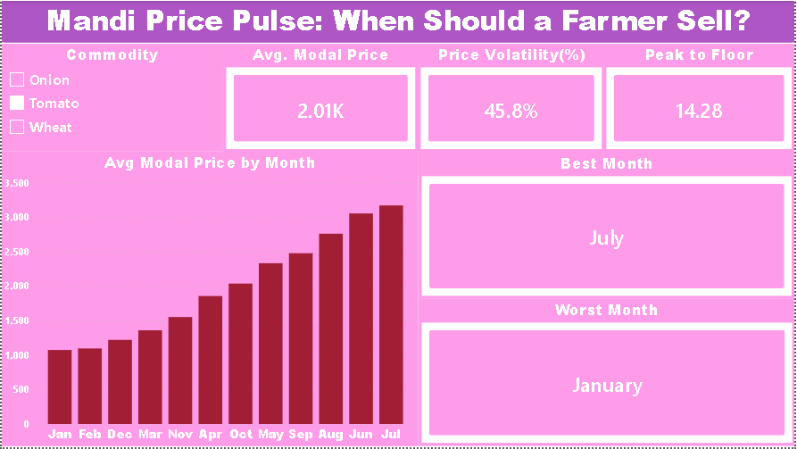
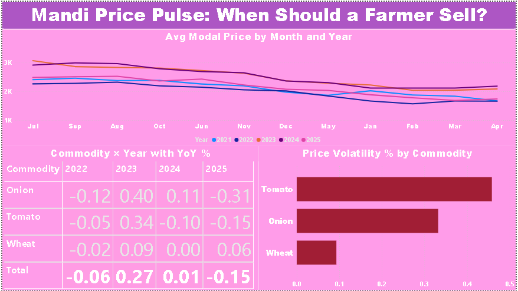
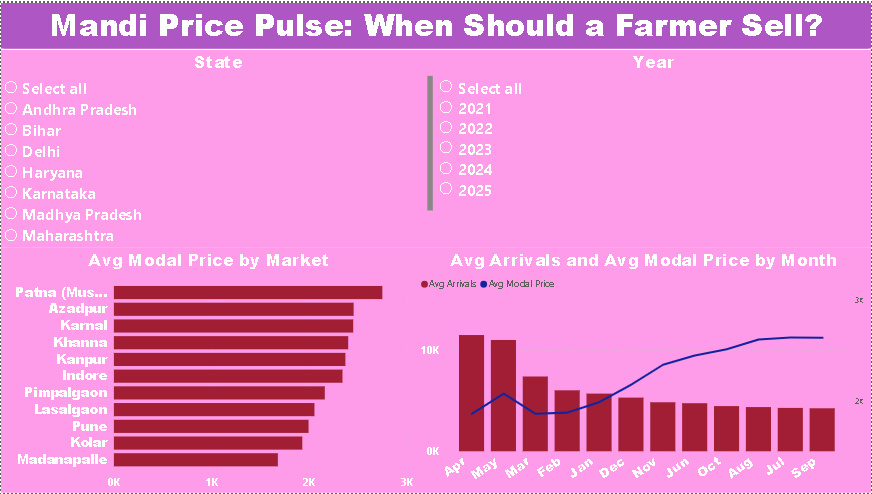

# Mandi Price Pulse: When Should a Farmer Sell?

**An end-to-end agricultural commodity price analysis using MySQL and Power BI.**
Which month, which market and which crop gives a farmer the best price for onion, tomato or wheat?


---

> ### ⚠️ Data disclosure
> **The dataset in this repository is synthetic (simulated), not real Agmarknet or mandi data.**
> I first tried real Agmarknet exports, but they were far too small for a seasonality study (112 onion rows, 4 tomato rows, one district only). So I generated a 5-year dataset (2021-2025) with realistic seasonal patterns, price spreads and arrival cycles, in order to practise the full SQL → Power BI workflow.
> **Every number below describes the simulated data.** They are not market advice, and they should not be used for real selling decisions. The method is fully reusable: swap in a real Agmarknet export with the same columns and every query and dashboard page will still work.

---

## Table of contents
1. [Business problem](#1-business-problem)
2. [Key findings](#2-key-findings)
3. [Tech stack and skills](#3-tech-stack-and-skills)
4. [Dataset](#4-dataset)
5. [Repository structure](#5-repository-structure)
6. [How to run it](#6-how-to-run-it)
7. [The 10 business questions (SQL)](#7-the-10-business-questions-sql)
8. [Power BI dashboard](#8-power-bi-dashboard)
9. [Challenges and what I learned](#9-challenges-and-what-i-learned)
10. [Limitations](#10-limitations)
11. [Future improvements](#11-future-improvements)
12. [About me](#12-about-me)

---

## 1. Business problem

Farmers rarely sell at the best price. Mandi prices rise and fall with the season, with how much produce arrives on a given day and with which market the crop is sold in. A farmer who sells in April instead of November can earn **half** as much for the same onions.

The goal is not to find the highest price ever, but to give a **defensible selling window** for each crop by answering questions like:

- **What** is the best and worst month to sell each crop?
- **Who** (which market) pays the most, and where are prices most stable?
- **Why** do prices crash in certain months, and why is tomato riskier than wheat?

## 2. Key findings

*(On the simulated 2021-2025 dataset.)*

| Crop | Best month | Worst month | Best 3-month window | Volatility (CV) | Peak-to-floor |
|---|---|---|---|---|---|
| **Onion** | November (Rs 3,086) | April (Rs 1,522) | Sep - Nov | 33.2% | 5.75x |
| **Tomato** | July (Rs 3,171) | January (Rs 1,074) | Jun - Aug | 45.8% | 14.28x |
| **Wheat** | February (Rs 2,523) | April (Rs 2,226) | Jan - Mar | 9.3% | 1.57x |

- **Timing matters more for perishables.** Tomato's best month pays about 3x its worst month. Wheat's gap is under 15%.
- **Tomato is the riskiest crop** (CV 45.8%), while wheat is the most stable (9.3%).
- **Market choice matters.** Highest average prices: Patna for onion (Rs 2,750), Azadpur for tomato (Rs 2,421), Karnal for wheat (Rs 2,451). Most stable: Azadpur (onion), Pune (tomato), Indore (wheat).
- **Supply drives price.** Months with high arrivals line up with low prices (onion −0.996, tomato −0.998 correlation). Note: a correlation this close to −1 is a sign the data is simulated, because real markets are never this clean. It shows the method, not a real-world finding.
- **Years differ.** Onion rose about 40% in 2023 and then fell about 31% in 2025.

## 3. Tech stack and skills

| Area | Tools and techniques |
|---|---|
| **Database** | MySQL 8.0, schema design, data import |
| **SQL** | Aggregations, CTEs, window functions (`RANK`, `LAG`, rolling `AVG`), `CASE`, correlated subqueries, date functions |
| **BI** | Power BI Desktop, data modelling (date dimension), slicers, KPI cards, combo charts, conditional formatting |
| **DAX** | `CALCULATE`, `ALLSELECTED`, `REMOVEFILTERS`, `TOPN`, `DIVIDE`, `STDEV.P`, ranking and YoY measures |
| **Analytics** | Seasonality, volatility (coefficient of variation), year-on-year change, supply-price association |
| **Communication** | Dashboard storytelling and a summary deck |

## 4. Dataset

- **File:** `data/mandi_prices.csv`, 17,496 rows, 11 columns
- **Period:** 1 Jan 2021 - 31 Dec 2025 (Monday to Saturday, with some random gaps)
- **Coverage:** 3 crops · 9 states · 10 districts · 11 markets
- **Units:** prices in INR per quintal, arrivals in quintals
- **Quality note:** about 1% of `Arrivals_Qtl` values are intentionally blank, to practise null handling.

| Column | Description |
|---|---|
| `Arrival_Date` | Trading date (YYYY-MM-DD) |
| `Commodity` | Onion, Tomato or Wheat |
| `State`, `District`, `Market` | Location of the mandi |
| `Variety`, `Grade` | Crop variety and grade (FAQ) |
| `Min_Price`, `Max_Price` | Lowest and highest price of the day |
| `Modal_Price` | Most common trading price (used as the "selling price") |
| `Arrivals_Qtl` | Quantity of produce arriving (quintals) |

## 5. Repository structure

```
mandi-price-pulse/
├── README.md
├── data/
│   └── mandi_prices.csv
├── sql/
│   ├── 01_setup_script.sql            # database + table
│   └── 02_business_questions.sql      # 10 analysis queries
├── dashboard/
│   └── mandi_price_pulse.pbix
├── images/
│   ├── 01_best_time_to_sell.png
│   ├── 02_price_trends_risk.png
│   └── 03_market_supply_impact.png
└── docs/
    └── mandi_price_pulse_presentation.pdf
```

## 6. How to run it

**Requirements:** MySQL 8.0+ and Power BI Desktop (Windows).

1. **Create the database and table**
   Run `sql/01_setup_script.sql`. It creates the `agriculture` database and the `dataset` table.
2. **Import the data**
   In MySQL Workbench, right-click the `dataset` table → *Table Data Import Wizard* → choose `data/mandi_prices.csv`.
   Or use the command line (replace the path, use forward slashes):
   ```sql
   LOAD DATA LOCAL INFILE 'C:/path/to/mandi_prices.csv'
   INTO TABLE dataset
   FIELDS TERMINATED BY ',' LINES TERMINATED BY '\n'
   IGNORE 1 ROWS
   (arrival_date, commodity, state, district, market, variety, grade,
    min_price, max_price, modal_price, @arr)
   SET quintal = NULLIF(TRIM(@arr), '');
   ```
   Check: `SELECT COUNT(*) FROM dataset;` should return **17,496**.
3. **Run the analysis**
   Run `sql/02_business_questions.sql` and read the output of each query.
4. **Open the dashboard**
   Open `dashboard/mandi_price_pulse.pbix`. If Power BI asks for the data source, point it to `data/mandi_prices.csv` (Home → Transform data → Data source settings).

## 7. The 10 business questions (SQL)

| # | Question | SQL techniques | Answer |
|---|---|---|---|
| 1 | **What** is the average modal price of each crop in each month? | `GROUP BY`, `AVG`, `MONTHNAME` | Clear seasonal curves per crop (onion ranges Rs 1,522 to 3,086) |
| 2 | **What** is the best and worst month to sell each crop? | CTE, `RANK()` | Onion Nov / Apr, tomato Jul / Jan, wheat Feb / Apr |
| 3 | **What** is the best 3-month selling window? | Rolling `AVG`, wrap-around window | Onion Sep-Nov, tomato Jun-Aug, wheat Jan-Mar |
| 4 | **What** is the price volatility of each crop? | `STDDEV`, coefficient of variation | Tomato 45.8%, onion 33.2%, wheat 9.3% |
| 5 | **What** was the biggest month-on-month spike or crash? | `LAG()`, % change | Onion −35% (Jan 2025), tomato +48% (Mar 2022) |
| 6 | **What** is the year-on-year change per crop? | `LAG()` by year | Onion +40% (2023) then −31% (2025); wheat within about ±9% |
| 7 | **Who** pays the highest average price? | `RANK() OVER (PARTITION BY ...)` | Patna (onion), Azadpur (tomato), Karnal (wheat) |
| 8 | **Who** has the most stable prices? | CV by market | Azadpur (onion), Pune (tomato), Indore (wheat) |
| 9 | **Why** do prices fall in certain months? | Correlation in SQL, `CASE` | High arrivals line up with low prices |
| 10 | **Why** is tomato riskier than wheat? | Subquery, spread and peak-to-floor | Tomato peaks at 14.3x its floor, wheat at 1.6x |

## 8. Power BI dashboard

### Page 1: Best Time to Sell
Pick a crop and instantly see its best and worst month, average price, volatility and peak-to-floor ratio.



### Page 2: Price Trends and Risk
Year-by-year monthly price curves, a Commodity × Year matrix with YoY change, and volatility by crop.



### Page 3: Markets and Supply Impact
Average price by market (with State and Year slicers) and a combo chart that compares arrivals to price by month.



### Key DAX measures

```DAX
Avg Modal Price = AVERAGE ( mandi_prices[Modal_Price] )

Price Volatility % =
DIVIDE ( STDEV.P ( mandi_prices[Modal_Price] ), [Avg Modal Price] )

Peak to Floor =
DIVIDE ( MAX ( mandi_prices[Modal_Price] ), MIN ( mandi_prices[Modal_Price] ) )

Best Month =
VAR T =
    ADDCOLUMNS ( ALLSELECTED ( DimDate[Month No] ), "@p", CALCULATE ( [Avg Modal Price] ) )
VAR MaxP = MAXX ( T, [@p] )
VAR M = MINX ( FILTER ( T, [@p] = MaxP ), DimDate[Month No] )
RETURN FORMAT ( DATE ( 2000, M, 1 ), "MMMM" )

YoY % =
VAR CurrYear = SELECTEDVALUE ( DimDate[Year] )
VAR CurrPrice = [Avg Modal Price]
VAR PrevPrice =
    CALCULATE ( [Avg Modal Price], REMOVEFILTERS ( DimDate[Year] ), DimDate[Year] = CurrYear - 1 )
RETURN
    IF ( ISBLANK ( CurrYear ) || ISBLANK ( PrevPrice ), BLANK (),
         DIVIDE ( CurrPrice - PrevPrice, PrevPrice ) )
```

## 9. Challenges and what I learned

- **Real data was too thin.** Public mandi exports I found covered one district and a few months. I learned to check coverage (time span, rows per crop, key columns) before committing to an analysis, and to be open about using simulated data.
- **`SAMEPERIODLASTYEAR` failed with a bi-directional relationship.** Time-intelligence functions need a clean, contiguous date selection. I fixed the relationship direction and rewrote the YoY measure with `REMOVEFILTERS` and a year offset.
- **Month order was alphabetical.** The month axis only sorts correctly when `Month` is set to *Sort by column → Month No*.
- **A "best month" measure needs to handle ties.** Ranking by price, then picking the earliest matching month, gives a stable result.
- **A near-perfect correlation is a red flag, not a win.** It is exactly what simulated data looks like. Real data would show a weaker, noisier relationship.

## 10. Limitations

- The data is simulated, so findings reflect the patterns built into it and not real market behaviour.
- The analysis is descriptive (what happened), not predictive. Historical patterns do not guarantee future prices.
- Storage, transport and spoilage costs are not modelled. They are central to a real selling decision, especially for tomato.
- Correlation between arrivals and price does not prove causation.

## 11. Future improvements

- Replace the simulated data with real **Agmarknet** or **data.gov.in** price and arrivals data and compare the findings.
- Add a forecasting layer (seasonal decomposition or Prophet) to estimate next-month prices.
- Add storage and transport cost inputs for a net-profit view by selling month.
- Add MSP (minimum support price) comparison for wheat.
- Publish the dashboard to Power BI Service.

## 12. About me

**Aayush Kumar Jha** · Aspiring Data Analyst (Delhi, India)
SQL · Python · Power BI · Excel · Tableau

- LinkedIn: [linkedin.com/in/aayushkumar-jha-84b7753bb](https://linkedin.com/in/aayushkumar-jha-84b7753bb)
- GitHub: [github.com/databyaayush](https://github.com/databyaayush)
- Portfolio: [databyaayush.github.io/myPortfolio](https://databyaayush.github.io/myPortfolio/)
- Email: aayush.jha.working@gmail.com

I'm open to **Data Analyst Intern** opportunities (Delhi NCR, hybrid or remote). If this project was useful, a ⭐ on the repo is appreciated.

---

*Keywords: mandi price analysis, agricultural commodity prices, onion tomato wheat price trends, price volatility, SQL business analysis, Power BI dashboard, DAX, data analytics portfolio project, Agmarknet.*
